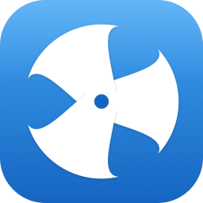

<p align="center">
  
</p>

# Whirr

A macOS app that tells you **why** your Mac or your connection feels slow — not just how slow.

Most performance monitors (Stats, iStat Menus, Activity Monitor) show gauges and let you draw your own conclusions. Whirr runs a rules engine over CPU, memory, swap, thermal, per-process activity and your network connection, and surfaces one plain-English answer with one thing to do: *"Backup is hammering your system — pause it"*, *"Wi-Fi is spiky — change your router's channel"*, *"Problem is past your router — here's what to tell your provider"*.

> Local, privacy-respecting, MIT-licensed, no telemetry. Network use: tiny pings to your router and 1.1.1.1 every 2 s (~10 MB/day), update checks, and the optional user-started connection test (~500 MB).

## Using Whirr

Whirr lives in the menu bar. The icon stays neutral unless a real problem has lasted two minutes; it only notifies for serious problems that last five minutes and have a fix. Click the icon for the headline, or **Open Whirr…** (or launch Whirr again from Spotlight) for the window:

- **Overview** — the one thing that matters right now, with its fix, plus Mac and Connection at a glance.
- **Mac** — findings, memory/disk/heat in plain words, and what's using your Mac.
- **Connection** — Wi-Fi signal, the two legs of your connection (Mac → router, Mac → internet) so you can tell Wi-Fi problems from provider problems, a *Check my connection* test with a plain-English report card, how each Wi-Fi channel has performed over time, and a dated outage log you can copy for your provider.
- **History** — the last 30 minutes, outages, past tests, and which problems recur.
- **Developer** — Docker containers and dev servers; appears only when Whirr detects them.

Every finding has **Snooze** and **This is normal for me**; muted findings are listed in Settings → Quieted.

<!-- TODO: drop a real menu screenshot at docs/screenshot-menu.png and uncomment.
<p align="center">
  
</p>
-->

## Table of contents

- [Requirements](#requirements)
- [Build](#build)
- [Optional: privileged sampler daemon](#optional-privileged-sampler-daemon)
- [Develop](#develop)
- [Architecture](#architecture)
- [Rules (v0.1)](#rules-v01)
- [Narratives](#narratives)
- [Auto-update (Sparkle)](#auto-update-sparkle)
- [License](#license)

## Requirements

- macOS 14 (Sonoma) or later
- Xcode command-line tools (`xcode-select --install`) — Swift 5.10+

## Build

```sh
./build.sh
open dist/Whirr.app
```

To install to `/Applications`:

```sh
./build.sh
cp -R dist/Whirr.app /Applications/
```

To launch at login: System Settings → General → Login Items → add Whirr.

### Optional: privileged sampler daemon

Without the daemon, Whirr can read CPU/memory/disk for processes owned by your user. To also see root-owned processes (`WindowServer`, `mds_stores`, `backupd`, Backblaze daemons, etc.), install the launchd-managed sampler:

```sh
./build.sh                          # builds the daemon binary too
sudo scripts/install-sampler.sh     # installs and starts the daemon
```

What the install script does (review it before running):

- Copies `whirr-sampler` to `/usr/local/bin/`
- Creates `/Library/Application Support/Whirr/` (root-owned)
- Drops `com.whirr.sampler.plist` in `/Library/LaunchDaemons/`
- Loads the daemon, which writes `snapshot.json` to the data dir every 3 seconds
- Logs to `/var/log/whirr-sampler.log`

The app automatically prefers the daemon's snapshot when it's fresh (< 10 s old) and falls back to in-process sampling otherwise. If the installed daemon is older than the app and its snapshot can't be read, the Mac section says so — re-run `sudo scripts/install-sampler.sh` after updating Whirr.

Output-path validation: the sampler refuses to write anywhere outside `/Library/Application Support/Whirr/`, even when launched with arbitrary command-line arguments. This is enforced even at root, so a misconfigured invocation can't redirect output.

To uninstall:

```sh
sudo scripts/uninstall-sampler.sh
```

## Develop

```sh
swift build                 # compile both targets
swift test                  # unit tests for the rules engine
swift run whirr-probe       # CLI probe — verifies samplers + rules, prints a snapshot
swift run Whirr             # run the menu bar app from terminal (logs to stdout)
```

The probe is the fastest way to verify a change against your real machine — no
rebuild of the app bundle needed. Useful flags:

```sh
swift run whirr-probe                       # standard: system + processes + rules
swift run whirr-probe --docker              # also hit Docker's Unix socket and dump
                                            # per-container CPU/mem (verifies the
                                            # DockerClient wire format end to end)
swift run whirr-probe --network             # 30 s of live router/internet pings,
                                            # Wi-Fi link details and connection
                                            # findings (history goes to a temp dir)
swift run whirr-probe --use-daemon          # read the installed sampler's snapshot
                                            # file and re-run the rules engine
                                            # against it — useful for testing rule
                                            # changes against root-process data
swift run whirr-probe <pid>                 # CPU-time API diagnostic for a single
                                            # pid (cross-check against `top`)
```

## Architecture

```
Sources/
  WhirrCore/                # Pure library — sampling and rules logic
    Models.swift            # Diagnosis, ProcessSample, SystemSnapshot, Severity
    SystemSampler.swift     # host_statistics64 + sysctl + thermalState
    ProcessSampler.swift    # proc_listpids + proc_pidinfo + proc_name (libproc)
    RulesEngine.swift       # Pluggable rules over the above
    Findings.swift          # Problem vs. note, area, suggested action (classifier post-pass)
    VerdictSelector.swift   # The one headline; icon + notification gating
    Connection/             # Pinger, Wi-Fi reader, stats, outages, history,
                            # connection rules, channel comparison, full test
  Whirr/                    # SwiftUI app (depends on WhirrCore)
    WhirrApp.swift          # @main: MenuBarExtra popover + main Window
    SystemMonitor.swift     # @Observable store + sampling loop
    MainWindow.swift        # Sidebar window
    Sections/               # Overview, Mac, Connection, History, Developer
    Resources/Info.plist    # LSUIElement=true (no dock icon)
  WhirrProbe/               # CLI test runner that prints a single diagnosis
  WhirrSampler/             # Privileged sampler daemon (run as root via launchd)
Tests/
  WhirrCoreTests/           # XCTest unit tests for the rules engine + payload codec
scripts/
  com.whirr.sampler.plist   # launchd plist for the sampler daemon
  install-sampler.sh        # one-time install (requires sudo)
  uninstall-sampler.sh      # tear-down (requires sudo)
```

Sampling runs every 3 seconds on a background actor; UI updates on `@MainActor`. Per-process CPU% is computed by diffing cumulative CPU times across two samples (same approach as `top`).

## Rules (v0.1)

- **MemoryPressureRule** — flags `.warning` / `.critical` based on free + compressed page ratios
- **SwapThrashingRule** — fires when ≥ 2 GB swap is in use; critical at 6 GB
- **ThermalThrottleRule** — surfaces `ProcessInfo.ThermalState ≥ .serious`
- **OverloadedSystemRule** — load average / core count ≥ 1.5
- **BackupHoggingRule** — Backblaze (`bzserv`, `bztransmit`), Time Machine (`backupd`), `rsync`, `restic`, `borg` — fires on either ≥ 5 % CPU or ≥ 5 MB/s sustained disk I/O (backups are usually I/O-bound, not CPU-bound)
- **HighDiskIORule** — any single non-backup process reading or writing ≥ 50 MB/s sustained; critical at 200 MB/s
- **RunawayProcessRule** — any single process ≥ 80% CPU

Adding a new rule = new `struct` conforming to `Rule` + one line in `RulesEngine.allRules`. Rules are pure functions of their inputs — see `Tests/WhirrCoreTests/RulesEngineTests.swift` for the testing pattern.

### Narratives

After the rules above fire, a second pass runs **narrative rules** that see the produced diagnoses and synthesize a multi-signal explanation. These render as a highlighted card at the top of the menu — the "why your Mac is slow" story rather than a list of facts.

- **BackupChokingForegroundNarrative** — backup hogging + any of (memory tight / swap / thermal) → "Foreground apps will feel frozen. Pause the backup."
- **MemorySwapSpiralNarrative** — memory saturated + heavy swap (no backup) → names your top memory hog as the fastest win.
- **ThermalThrottleAmplifierNarrative** — thermal throttle + a CPU-pegged process → "Cooling matters more than killing right now."
- **DiskMemoryContentionNarrative** — heavy disk I/O + memory pressure (no backup or memory-swap spiral) → "Disk and memory are fighting for the same SSD."

Precedence is hand-wired: more specific narratives suppress less specific ones via the conditions they check, not by inspecting each other's titles. Add a precedence test alongside any new narrative.

## Auto-update (Sparkle)

Whirr embeds [Sparkle 2](https://sparkle-project.org/) so released builds can update themselves. The plumbing is in place; flipping it on takes three one-time setup steps and a per-release sign step.

### One-time setup

1. **Pick a host for the appcast XML.** Anything that can serve a static file over HTTPS works — GitHub Pages, S3, your own domain. Write the URL into `Sources/Whirr/Resources/Info.plist` at the `SUFeedURL` key (replace `https://YOUR_DOMAIN/whirr/appcast.xml`).
2. **Generate signing keys.** Download Sparkle's release artifact (the same `Sparkle-for-Swift-Package-Manager.zip` SPM already pulled into `.build/artifacts/sparkle/`) — inside its `bin/` directory:
   ```sh
   ./generate_keys
   ```
   This stores the private key in your macOS Keychain (item: "https://sparkle-project.org") and prints the public key to stdout. Paste the public key into `Info.plist` at `SUPublicEDKey`. Commit both Info.plist changes.
3. **Verify the loader entitlement is signed in.** `codesign -d --entitlements - dist/Whirr.app` should show `com.apple.security.cs.disable-library-validation: true`. `build.sh` already passes this; nothing to do unless you've forked the build script.

### Per-release flow

After running `./build.sh`:

1. Zip the bundle: `ditto -c -k --sequesterRsrc --keepParent dist/Whirr.app dist/Whirr.zip`
2. Sign the update: `./sign_update dist/Whirr.zip` (the `sign_update` CLI lives in the same Sparkle release artifact). Output is an `sparkle:edSignature="…" length="…"` snippet.
3. Upload `Whirr.zip` to the same host as the appcast.
4. Append a new `<item>` to `appcast.xml` with the version, release notes, file URL, and the `sparkle:edSignature` + `length` from step 2.
5. Existing installs will pick up the update on their next scheduled check (Sparkle's default cadence is roughly daily).

### Gotchas

- Until you have a **Developer ID** code-signing certificate, updated builds will hit the same Gatekeeper "Apple cannot check for malicious software" friction as the initial download. Sparkle's EdDSA signature verifies that *the update came from you*; Gatekeeper's Dev ID verifies that *macOS trusts you to ship code at all*. They're separate checks. Wire up Dev ID before promoting auto-update to non-technical users.
- The "Check for Updates…" button in Settings → About shows "Auto-update not yet configured" until you replace the `YOUR_DOMAIN` placeholder in `SUFeedURL`.

## License

MIT — see [LICENSE](LICENSE).
